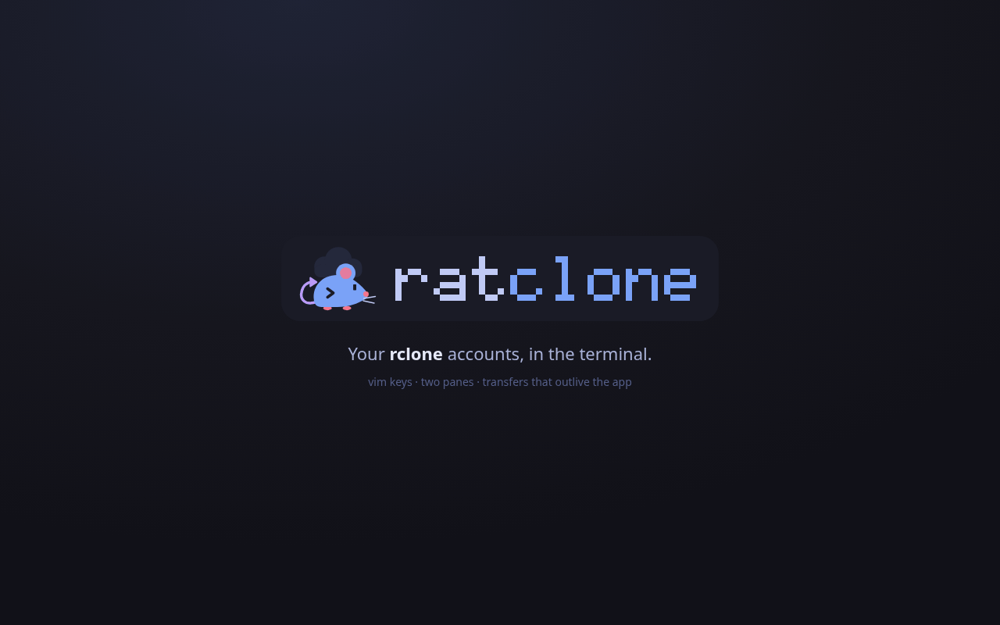
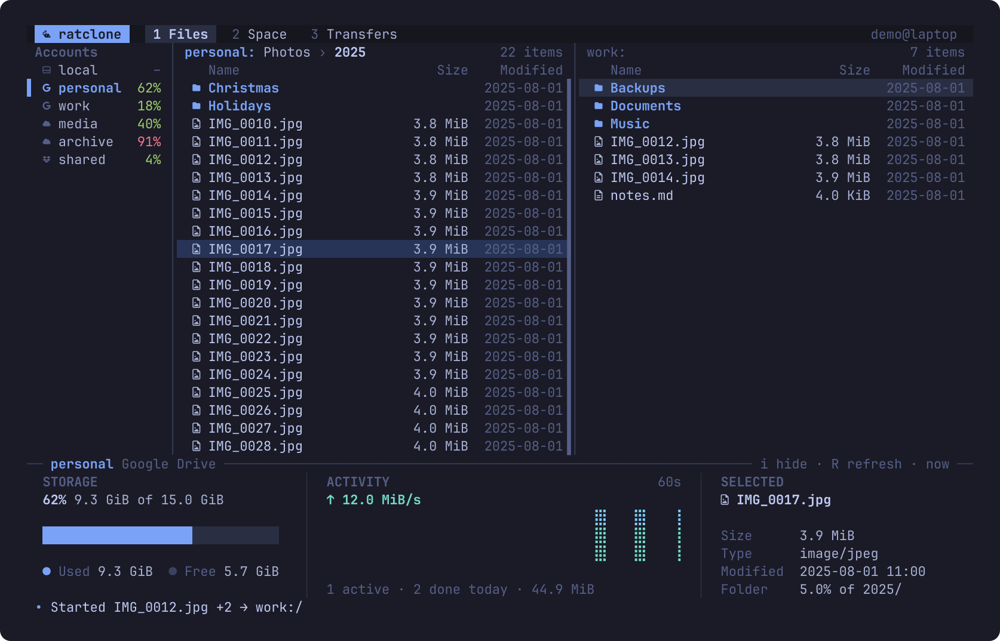
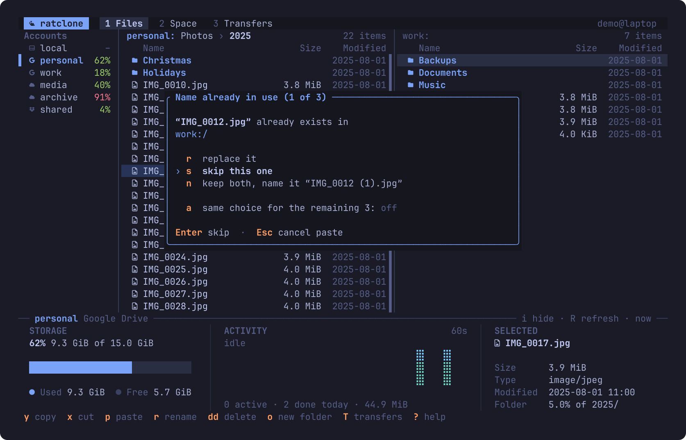

<div align="center">


A keyboard-driven terminal UI for rclone, with Vim keys.

[](https://github.com/SyscallBrain/ratclone/actions/workflows/ci.yml)
[](https://github.com/SyscallBrain/ratclone/releases/latest)
[](https://crates.io/crates/ratclone)
[](https://syscallbrain.github.io/ratclone/)
[](LICENSE)
[](https://www.rust-lang.org)
[](https://ratatui.rs)
[](https://rclone.org)
[](#install)

[Documentation](https://syscallbrain.github.io/ratclone/) ·
[Install](#install) ·
[Screenshots](#screenshots) ·
[Key bindings](https://syscallbrain.github.io/ratclone/keys.html) ·
[Changelog](CHANGELOG.md) ·
[Report a bug](https://github.com/SyscallBrain/ratclone/issues/new?template=bug_report.yml)

</div>



ratclone browses your [rclone](https://rclone.org) accounts and the local disk
with Vim keys, in one pane or two side by side. Copy and move between them,
rename and delete, and keep transfers running in the background, even after
you quit or your SSH session drops.

## Features

- Every rclone account and the local disk, browsed with Vim keys, in one pane
  or two side by side.
- Copy and move between any two places. When a name is already taken, choose:
  replace, skip or keep both, once or for all of them.
- Every copy and move is an rclone job: transfers keep going while you browse
  and, if you choose, after you quit. Reopen the app and they are still there.
- The Transfers tab shows progress per file, speed, and the `rclone` command
  behind each transfer.
- The Space tab shows where an account's space goes: folders ranked by size,
  file types and the largest files.
- Add, edit and sign in to accounts from the app, with browser logins that
  work over SSH too.
- Eleven built-in themes plus your own, a settings screen that restyles live,
  and Nerd Font or ASCII icons.
- `--demo` to try everything on made-up accounts.

## Screenshots

| | |
|:-:|:-:|
|  |  |
| Two panes, with a copy running | When a name is already taken |
|  |  |
| Transfers, with the rclone command | Space: where the space goes |

<details>
<summary>Settings and themes</summary>


</details>

The presentation and the screenshots come from `--demo` mode, with made-up
accounts.

## Install

You need Linux on x86_64 or aarch64 and **rclone v1.68.0 or newer**. Debian
and Ubuntu ship rclone 1.60, which is too old: install the current one from
[rclone.org](https://rclone.org/install/) with
`sudo -v ; curl https://rclone.org/install.sh | sudo bash`.

Browser login inside the app requires **rclone v1.75.0 or newer** so it can
be cancelled cleanly. Older supported versions automatically offer the
authorization-token flow instead; existing accounts work as usual.

Download the file for your system from the
[latest release](https://github.com/SyscallBrain/ratclone/releases/latest).
x86_64 packages are named `amd64` or `x86_64`, and aarch64 packages `arm64`
or `aarch64`. `SHA256SUMS` lists the checksum of every file. The binary is
static, so it runs on any distribution whatever its glibc.

| System | Install |
|---|---|
| Arch Linux | `paru -S ratclone-bin` (or `ratclone` to build from source) from the AUR, or `sudo pacman -U ./ratclone-*-x86_64.pkg.tar.zst` |
| Debian, Ubuntu | `sudo apt install ./ratclone_*_amd64.deb` |
| Fedora, RHEL | `sudo dnf install ./ratclone-*.x86_64.rpm` |
| openSUSE | `sudo zypper install --allow-unsigned-rpm ./ratclone-*.x86_64.rpm` |
| Any other Linux | unpack the `.tar.gz` and put `ratclone` on your `PATH` |

To build it yourself you need Rust 1.88 or newer. It is on
[crates.io](https://crates.io/crates/ratclone):

```sh
cargo install --locked ratclone
```

For the icons, use a terminal with a [Nerd Font](https://www.nerdfonts.com),
or set `icons = "ascii"`. The
[installation guide](https://syscallbrain.github.io/ratclone/installation.html)
has the details.

## Quick start

```sh
ratclone                    # your rclone accounts
ratclone --demo             # made-up accounts, nothing touches yours
ratclone --rclone ~/bin/rclone
```

| Key | Action |
|-----|--------|
| `j` `k` `h` `l`, `gg` `G` | move, parent, open, top, bottom |
| `Tab` | move between the accounts and the panes |
| `\|` | open or close a second pane |
| `Space`, `v` | mark, visual selection |
| `y` / `x` then `p` | copy / cut, then paste here |
| `>` or `F5`, `F6` | copy, move to the other pane |
| `r`, `o`, `dd` | rename, new folder, delete |
| `/` | filter |
| `T`, `U` | Transfers, Space |
| `a` `e` (accounts list) | add, edit an account |
| `,` | settings |
| `?` | all key bindings |
| `q` | quit (asks what to do with running transfers) |

## How it works

ratclone starts its own `rclone rcd` on a private unix socket and talks to it
through the rc API, which is only available through that socket. Browser logins
may temporarily open a localhost port for OAuth. Copies and moves are
rclone jobs, so they outlive the app: a small helper records how each one ends
and stops the rcd once they are done. See
[How it works](https://syscallbrain.github.io/ratclone/how-it-works.html).

## Documentation

The [user guide](https://syscallbrain.github.io/ratclone/) covers the
interface, copying and transfers, Space, accounts, settings, configuration,
themes and troubleshooting. Its source is in [`book/`](book/src/SUMMARY.md).

## Contributing

Bug reports, ideas and pull requests are welcome; questions go to
[Discussions](https://github.com/SyscallBrain/ratclone/discussions). Read
[CONTRIBUTING.md](CONTRIBUTING.md) for how to build and test.

## License

[MIT](LICENSE) © 2026 Tiago Correia
