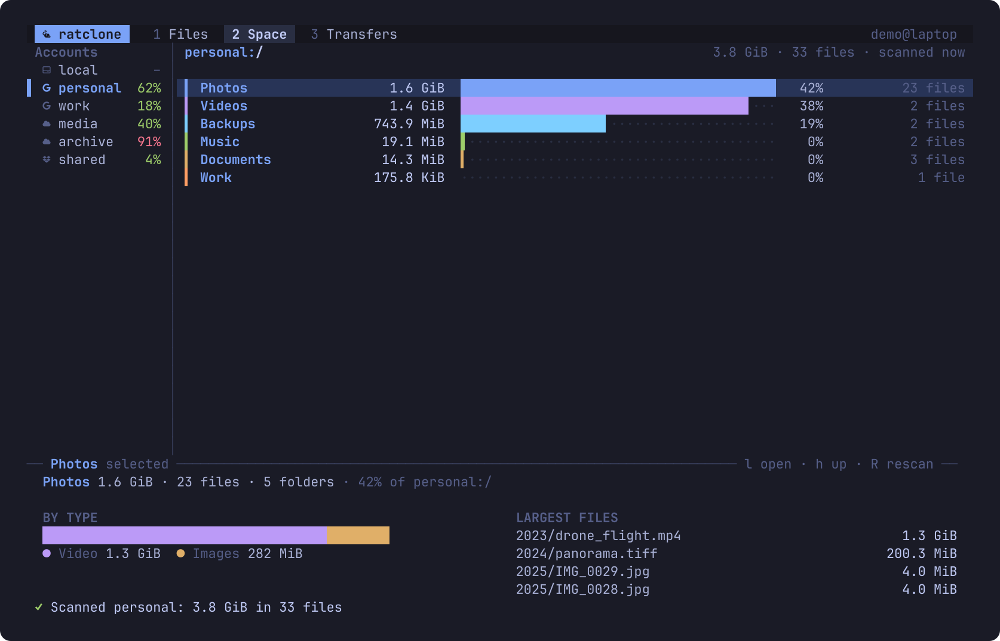
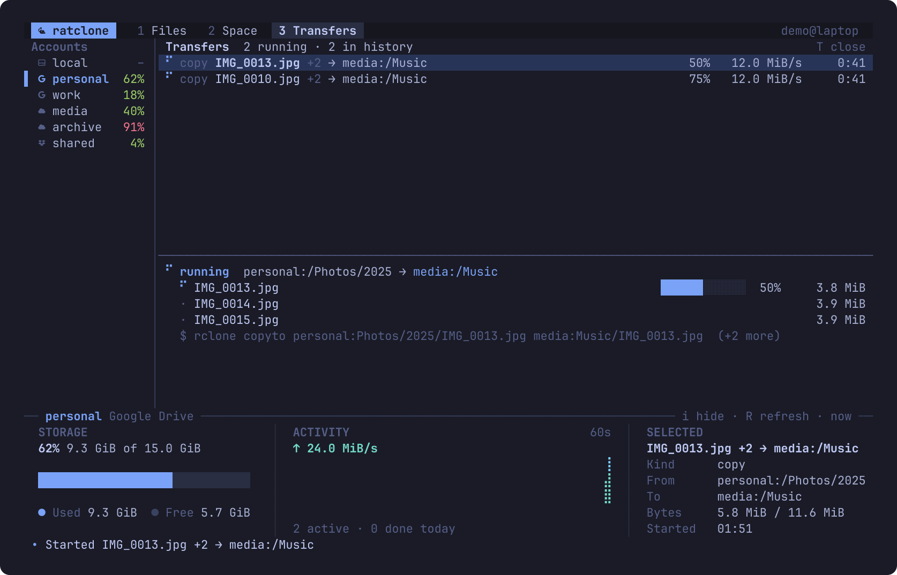
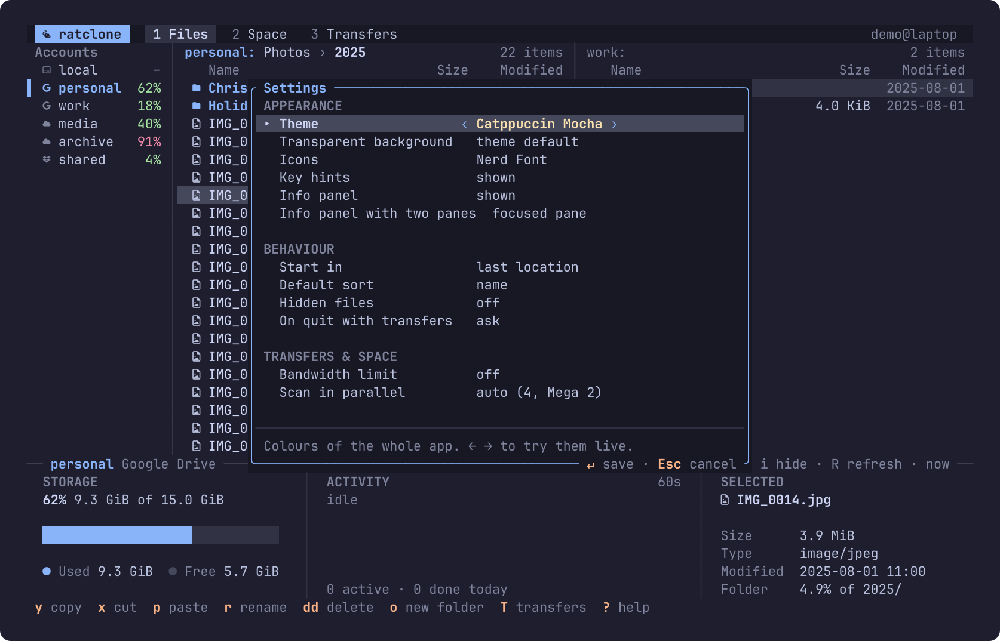

<p align="center">
  
</p>

<p align="center">
  <a href="https://github.com/SyscallBrain/ratclone/actions/workflows/ci.yml"></a>
  <a href="LICENSE"></a>
  
  
  <a href="https://rclone.org"></a>
</p>

# ratclone

A keyboard-driven terminal UI for [rclone](https://rclone.org), with Vim keys.
Browse your accounts and the local disk, copy and move between them, rename and
delete, and keep transfers running in the background — even after you quit.


## Requirements

- Linux
- rclone **v1.68.0** or newer (accounts can be added from the app, or with `rclone config`)
- A terminal with a [Nerd Font](https://www.nerdfonts.com) for icons
  (or set `icons = "ascii"`)

## Install

With Rust 1.88 or newer:

```sh
cargo install --path .
```

Try it without touching your accounts:

```sh
ratclone --demo
```

## Screenshots

These come from `ratclone --demo`, so you can open the same screens yourself.

Two panes, with `|`: Photos on `personal` on the left, the `work` account on the
right. `>` copied three photos across, and the copy is still running.


Copying the same photos again: a name is already taken on the other side, so the
app asks whether to replace, skip or keep both, once or for all of them.


The Space tab after scanning `personal`. Photos holds 42% of what it found, and the
panel below splits it by file type and lists its largest files.



Two copies to `media` (Mega) running at 12 MiB/s each. Under the list, the
selected copy shows each file with its size and progress, and the `rclone`
command behind it.



Settings, trying out Catppuccin Mocha. The app restyles as you press `←` `→`,
and `Esc` puts the old theme back.



## How it works

ratclone starts its own `rclone rcd` on a private unix socket
(`$XDG_RUNTIME_DIR/ratclone/rc.sock`) and talks to it through the rc API.
Copies and moves are rclone jobs, so they keep going while you browse — and,
if you choose, after you quit. Reopen the app and they are still there, running
or with how they ended. The same happens when the terminal is closed or an SSH
session drops: the app leaves, the transfers carry on.
Every operation shows the equivalent `rclone` command.
Only one ratclone runs at a time. When transfers are left running in the
background, a small helper records how each one ends and stops the rcd once
they are done.

Folders you visited recently open at once with the rows seen last time, while
a fresh listing is fetched (a spinner next to the item count). Until it
arrives you can move around and filter, but not change anything.

## Info panel and Space

The panel at the bottom shows the selected account: storage used, trash and
free space, a sparkline of transfer speed over the last minute, and details of
the file under the cursor. `i` hides it; short terminals get a one-line version.

The **Space** tab (`U`) shows where an account's space goes: folders ranked by
size with bars, the file types inside the selected folder, and its largest
files. It is read-only. A scan never starts by itself — press `Enter` — and
lists folders a few at a time (4, or 2 on Mega; set `scan_concurrency` in
`config.toml` to change it). `Esc` cancels and keeps what was found. Results
are cached in `~/.cache/ratclone/scans` and shown at once next time; `R`
rescans. In Space: `l`/`h` go in and out of folders, `ss` `sn` `sc` sort by
size, name or file count, `/` filters, and `gf` opens the folder in Files.

## Settings

`,` opens the settings over the app. Changes show at once: cycle the themes
and watch the whole app restyle. `Enter` saves to `~/.config/ratclone/config.toml`
(your comments and other keys are kept; values left at their default are
removed), `Esc` puts everything back.

| Setting | Values | `config.toml` |
|---|---|---|
| Theme | Tokyo Night (default) and the other built-ins, plus your own `themes/*.toml` | `theme` |
| Transparent background | theme default · on · off | `transparent` |
| Icons | Nerd Font · ASCII | `icons` |
| Key hints | shown · hidden | `key_hints` |
| Info panel | shown · hidden | `info_panel` |
| Info panel with two panes | focused pane · hidden | `info_panel_split` (`focused`/`hidden`) |
| Start in | last location · home folder · an account | `start_in` |
| Default sort | name · size · modified | `sort` |
| Hidden files | off · on | `show_hidden` |
| On quit with transfers | ask · keep running · wait | `on_quit` (`ask`/`background`/`wait`) |
| Bandwidth limit | off · 1M · 5M · 10M · 50M · custom (`750k`, `10M:1M`) | `bwlimit` |
| Scan in parallel | auto · 1 · 2 · 4 · 8 · 16 | `scan_concurrency` (any number from 1 to 16) |

The quick keys `i`, `.` and `s…` change only the current session.

## Accounts

From the accounts list (`Tab` to focus it):

- `a` adds an account. Pick a type (type to filter), give it a name, fill in its
  fields (`Tab` shows the advanced ones, `F1` the full help, `Ctrl-d` puts a field
  back to rclone's default, `Ctrl-o` on a remote path picks one of your accounts
  or the local disk). `Enter` on the last field or `Ctrl-s` sends it. Then
  answer rclone's own questions, such as the login.
- `e` edits the selected account. The form opens filled in. Passwords show as
  `••••• (unchanged)` and are only sent if you type a new one. Only the fields you
  change are sent.
- `A` signs in again (a new token), for accounts that log in through a browser.
- `dd` or `D` removes the account from rclone's config, after asking. The files in
  the account are not touched. Accounts built on it (crypt, alias, union) are
  listed in the question. It is refused while transfers use it.

**Browser logins** (Google Drive, Dropbox, OneDrive…): on your own computer, the
browser opens and the app waits for you. Over SSH there is no browser, so the app
shows the command to run on a machine that has one (`rclone authorize "dropbox"`).
`y` copies it (OSC 52, through SSH too), and you paste the result back. `L` switches
between the two ways if the guess was wrong. `Esc` cancels. A cancelled new account
is removed, so nothing half-made stays in `rclone.conf`.

## Keys

| Keys | Action |
|---|---|
| `j` `k` `h` `l`, `gg` `G`, `Ctrl-d` `Ctrl-u` | move, parent, open, top, bottom, half page |
| `Tab` `Shift-Tab` | move between the accounts and the panes |
| `Ctrl-n` `Ctrl-p` | next / previous account, from the pane (Files and Space) |
| `\|` | open or close a second pane beside the first |
| `-` | previous folder |
| `R` | refresh the folder and its account's usage |
| `/` then `n` `N` | filter the folder, cycle matches |
| `Space`, `v` | mark, visual selection |
| `y` / `x` then `p` | copy / cut, then paste here |
| `>` or `F5`, `F6` | copy, move the marked files to the other pane |
| `r` or `cw` | rename |
| `o` | new folder |
| `dd` or `D` | delete (asks first) |
| `sn` `ss` `sm` `sr`, `.` | sort by name/size/modified, reverse, hidden files |
| `T` | transfers: `s` stop, `Enter` resume, `c` clear finished, `dd` remove one, `C` clear all but running |
| `gt` `gT`, `Alt-1` `Alt-2` `Alt-3` | next/previous tab, go to Files / Space / Transfers |
| `U` | Space: where an account's space goes |
| `i` | show or hide the info panel |
| `a` `e` `A` `dd` (accounts list) | add, edit, sign in again, remove an account |
| `,` | settings |
| `?` | all keys |
| `q` or `Ctrl-c` | quit (asks what to do with running transfers) |

Counts work with movement: `5j`.

Text pasted into the terminal only ever goes into the text field being edited
(a name, a filter, a token). Anywhere else it is ignored, so a stray paste can
never be read as keys.

## Configuration

`~/.config/ratclone/config.toml`:

```toml
theme = "tokyo-night"   # tokyo-night(-storm|-moon|-day), catppuccin-mocha|latte,
                        # gruvbox-dark, nord, dracula, kanagawa, everforest
icons = "nerd"          # or "ascii"
show_hidden = false
rclone_path = "/usr/bin/rclone"
```

Custom themes go in `~/.config/ratclone/themes/<name>.toml` with a `[tokens]`
table of 16 colours (`bg bg2 hl sel gutter comment fg fg2 blue cyan magenta
green yellow orange red teal`).

## Files

- `~/.config/ratclone/config.toml`, `themes/` — settings and custom themes
- `~/.local/state/ratclone/transfers.json` — transfer history
- `~/.local/state/ratclone/ui.json` — where the Files tab was when you last quit
- `~/.local/state/ratclone/rcd.log` — the rcd's log (rotated at 10 MiB)
- `~/.local/state/ratclone/lists/` — file lists for multi-file pastes
- `~/.cache/ratclone/scans/` — Space scans

## License

MIT © 2026 Tiago Correia — see [LICENSE](LICENSE).
