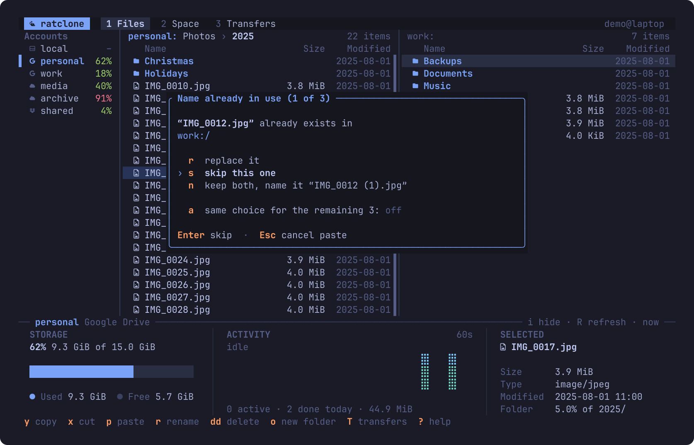

# Copying, moving and deleting

## Choosing files

- `Space` marks or unmarks the file under the cursor.
- `v` (or `V`) starts a visual selection: move with `j` `k` and every file in
  between is selected.
- `Esc` clears the marks.

With nothing marked, operations act on the file under the cursor.

## Copy and move

There are two ways, and both run as rclone jobs in the background.

**To the other pane.** With two panes open (`|`), `>` or `F5` copies the
marked files to the folder in the other pane, and `F6` moves them.

**Copy and paste.** `y` copies the marked files, `x` cuts them; go to any
folder, on any account, and `p` pastes them there.

Copies between two folders of the same account are done by the cloud
provider where it can (a server-side copy), so nothing goes through your
computer.

## When a name is already taken

If a file or folder with the same name is already in the destination, ratclone
asks what to do:

- `r` replaces it (not possible when one is a file and the other a folder),
- `s` skips this one,
- `n` keeps both, and gives the new one a free name, shown in the question.

With several conflicts, `a` applies the same choice to all the remaining ones.
`Enter` confirms, `Esc` cancels the paste. Inside folders, rclone itself skips
identical files and overwrites the ones that differ.

## Rename, new folder, delete

- `r` or `cw` renames the file under the cursor.
- `o` (or `a`) creates a new folder.
- `dd` or `D` deletes the marked files, or the one under the cursor, after
  asking.

## The rclone command

The delete question lists the `rclone` commands it will run, and the
[Transfers](transfers.md) tab shows the command behind each copy and move, so
you can learn them or repeat them in a script.
