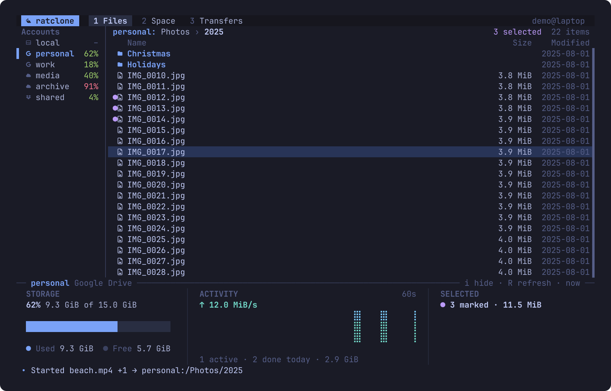
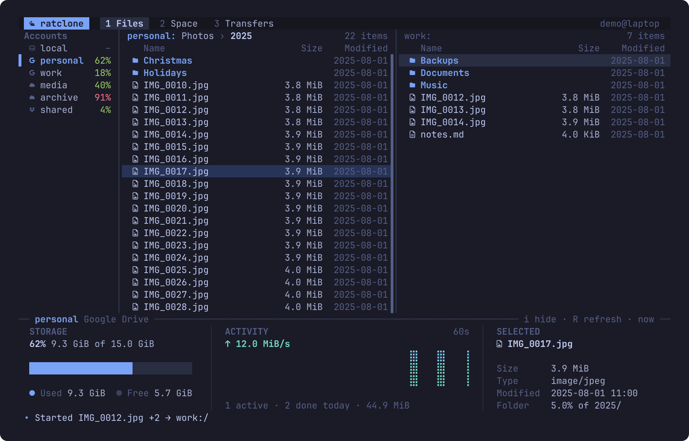

# The interface

## Tabs

The top line shows the three tabs:

- **Files** (`Alt-1`): the accounts list and one or two file panes.
- **Space** (`Alt-2`, or `U`): [where an account's space goes](space.md).
- **Transfers** (`Alt-3`, or `T`): [running and finished transfers](transfers.md).

`gt` and `gT` go to the next and previous tab.

## Accounts list

The left column lists the local disk and every rclone account, with how full
each one is. `Tab` focuses it; `j` `k` and `Enter` open an account in the
pane. From the pane, `Ctrl-n` and `Ctrl-p` switch to the next or previous
account without leaving it. The [accounts](accounts.md) chapter covers adding
and editing them.

On terminals narrower than 80 columns the accounts list is hidden, to leave
room for the files.

## File panes

The pane shows the folder you are in: its path on the top border, the number
of items, and the marked count. `sn` `ss` `sm` sort by name, size or
modification time, `sr` reverses the order, and `.` shows hidden files.

`|` opens a second pane beside the first, and closes it again. `Tab` and
`Shift-Tab` move between the accounts list and the panes.

Folders you visited recently open at once with the rows seen last time, while
a fresh listing is fetched (a spinner next to the item count). Until it
arrives you can move around and filter, but not change anything. `R`
refreshes the folder and the account's usage.

## Info panel

The panel at the bottom shows the selected account: storage used, trash and
free space, a sparkline of transfer speed over the last minute, and details of
the file under the cursor. `i` hides and shows it. Short terminals get a
one-line version. With two panes open, it follows the focused pane, or stays
hidden if you choose so in the [settings](settings.md).

## Bottom line

The last line shows messages and the keys that make sense where you are. The
key hints can be hidden in the settings.

## Help

`?` opens every key, grouped by what it does. The [key bindings](keys.md)
chapter has the same list.

## Pasting text

Text pasted into the terminal only ever goes into the text field being edited
(a name, a filter, a token). Anywhere else it is ignored, so a stray paste can
never be read as keys.
