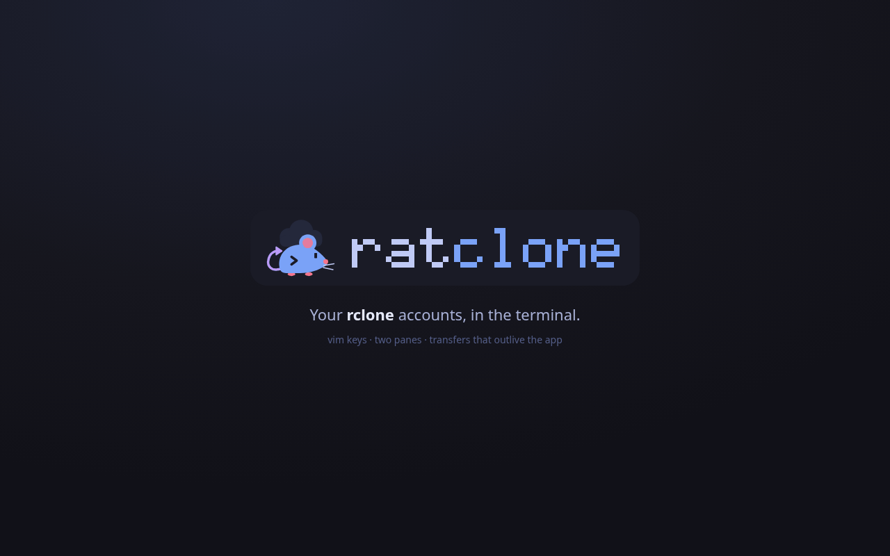

  

ratclone is a keyboard-driven terminal UI for [rclone](https://rclone.org),
with Vim keys. Browse your accounts and the local disk, copy and move between
them, rename and delete, and keep transfers running in the background, even
after you quit.

## What it does

- Browses every rclone account and the local disk, in one pane or two side by
  side.
- Copies and moves files between any two places, with a question when a name
  is already taken: replace, skip or keep both, once or for all of them.
- Runs every copy and move as an rclone job. Transfers keep going while you
  browse and, if you choose, after you quit or your SSH session drops.
- Shows the equivalent `rclone` command for copies, moves and deletes.
- Shows where an account's space goes, with folders ranked by size, file
  types and the largest files.
- Adds, edits and signs in to accounts, including browser logins over SSH.
- Restyles live: eleven built-in themes, your own themes, Nerd Font or ASCII
  icons.

## Where to start

- [Installation](installation.md): packages for Debian, Ubuntu, Fedora,
  openSUSE and Arch, a static binary for any Linux, or `cargo install`.
- [Getting started](getting-started.md): the first run, and `--demo` to look
  around without touching your accounts.
- [Key bindings](keys.md): every key on one page.

ratclone is free software under the MIT licence. The source, issues and
discussions are on [GitHub](https://github.com/SyscallBrain/ratclone).
