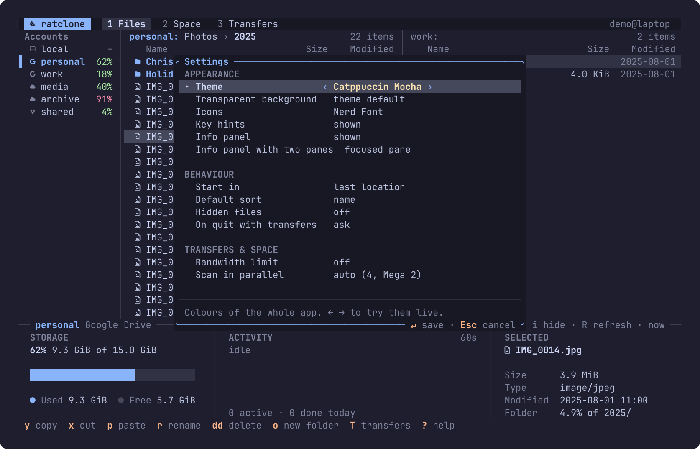

# Settings

`,` opens the settings over the app. Changes show at once: cycle the themes
with `←` `→` and watch the whole app restyle. `Enter` saves to
`~/.config/ratclone/config.toml`, and `Esc` puts everything back.

Saving keeps your comments and any other keys in the file. Values left at
their default are removed, so the file only holds what you changed.

| Setting | Values | `config.toml` |
|---|---|---|
| Theme | Tokyo Night (default) and the other built-ins, plus your own `themes/*.toml` | `theme` |
| Transparent background | theme default · on · off | `transparent` |
| Icons | Nerd Font · ASCII | `icons` |
| Key hints | shown · hidden | `key_hints` |
| Info panel | shown · hidden | `info_panel` |
| Info panel with two panes | focused pane · hidden | `info_panel_split` |
| Start in | last location · home folder · an account | `start_in` |
| Default sort | name · size · modified | `sort` |
| Hidden files | off · on | `show_hidden` |
| On quit with transfers | ask · keep running · wait | `on_quit` |
| Bandwidth limit | off · 1M · 5M · 10M · 50M · custom | `bwlimit` |
| Scan in parallel | auto · 1 · 2 · 4 · 8 · 16 | `scan_concurrency` |

The quick keys `i` (info panel), `.` (hidden files) and `s…` (sort) change
only the current session. The [configuration](configuration.md) chapter
describes every key of the file.
