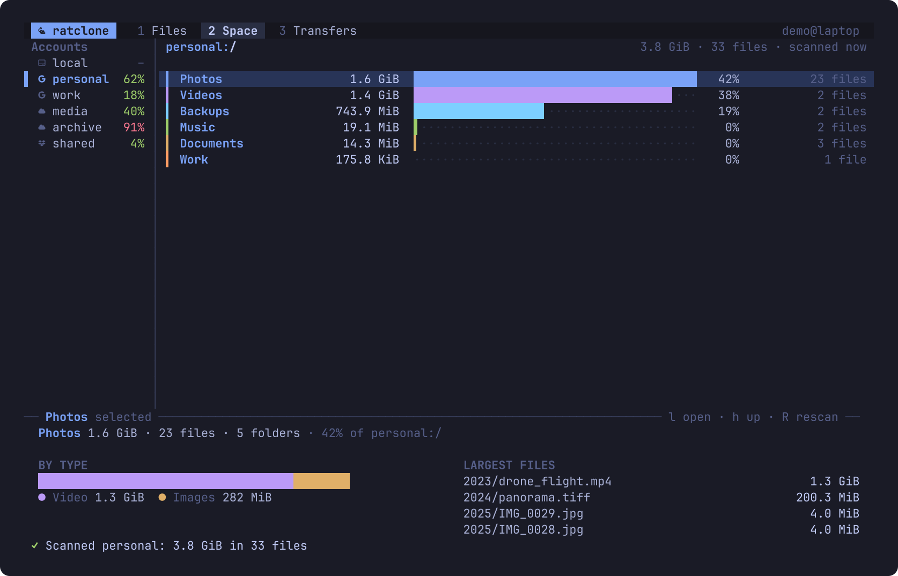

# Space

The **Space** tab (`U`, or `Alt-2`) shows where an account's space goes:
folders ranked by size with bars, the file types inside the selected folder,
and its largest files. It is read-only: nothing is changed from here.

## Scanning

A scan never starts by itself: press `Enter` to scan the account. It lists
folders a few at a time (4, or 2 on Mega, which limits requests); set
**Scan in parallel** in the [settings](settings.md), or `scan_concurrency` in
`config.toml`, to change it. `Esc` cancels and keeps what was found so far.

Results are cached in `~/.cache/ratclone/scans` and shown at once the next
time. `R` scans again.

## Keys

| Key | Action |
|-----|--------|
| `j` `k`, `gg` `G`, `Ctrl-d` `Ctrl-u` | move |
| `l` or `Enter` | open the folder (on the account, start the scan) |
| `h` or `-` | parent folder |
| `ss` `sn` `sc` | sort by size, name or file count |
| `/` | filter |
| `gf` | open the folder in the Files tab |
| `R` | scan again |
| `Esc` | cancel the scan, or go back |
| `q` | back to the files |
| `Tab` | switch to the accounts list |
