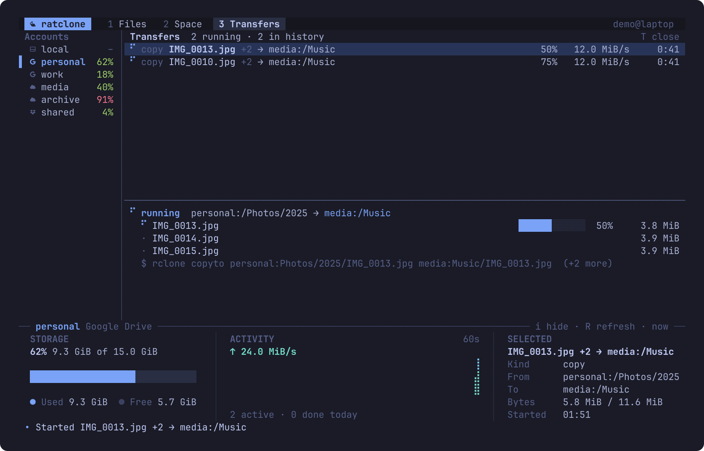

# Transfers

Every copy and move is an rclone job. The **Transfers** tab (`T`, or `Alt-3`)
lists them: running, finished, stopped and failed, with their speed and
progress. Under the list, the selected transfer shows each file with its size
and progress, and the `rclone` command behind it.

| Key | Action |
|-----|--------|
| `j` `k`, `gg` `G` | move |
| `s` or `x` | stop the transfer |
| `Enter` or `r` | resume a stopped or failed transfer |
| `c` | clear the finished transfers |
| `dd` or `D` | remove one transfer from the list |
| `C` | clear everything but the running ones |
| `T`, `q` or `Esc` | back to the files |

## In the background

Transfers do not need the app. Quit with transfers running and ratclone asks:

- `b`: quit and keep them running in the background,
- `w`: wait for them to finish, then quit,
- `c`: cancel them and quit.

Set **On quit with transfers** in the [settings](settings.md) to make this
choice once and for all.

Background transfers keep going when the terminal is closed or an SSH session
drops. A small helper records how each one ends and stops rclone once they are
done. Open the app again and they are still there, running or with how they
ended. The history is kept in `~/.local/state/ratclone/transfers.json`.

## Bandwidth

The **Bandwidth limit** setting caps the speed of every transfer, in rclone's
syntax: `10M` for 10 MiB/s, `750k`, or `10M:1M` for separate upload and
download limits.
